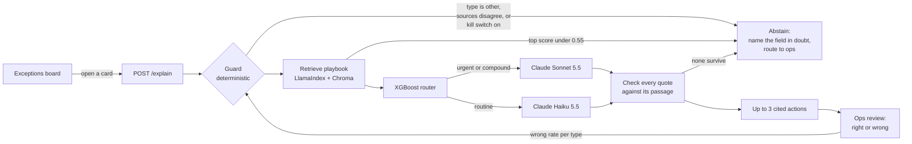

# Freight exceptions copilot

**[Open the live demo →](https://superposition-fc23.github.io/freight-exceptions-copilot/)** &nbsp;·&nbsp; [The case: requirements and prototype](https://superposition-fc23.github.io/freight-exceptions-copilot/case/)

A self-serve exceptions dashboard for a digital freight forwarder's customers. It started as a 45-minute, AI-assisted product case (requirements plus a front-end prototype) and was then built out, one commit at a time, into a working stack: retrieval over a resolution playbook, a model router, a deterministic guard, citation checks, ops corrections with a kill switch, and live evals.

The hosted demo replays responses recorded from a live run, so it needs no API key; the header says so. Run it locally for live Claude calls.

## The brief

Importers find out that a shipment has a problem (a customs hold, a missed vessel, a document error) late, usually in an email from their ops contact, and then wait for someone to tell them what to do. Design a self-serve experience that lets the customer see exceptions as they happen and act on them, with the forwarder's ops team as the backstop. Define testable requirements, scope a v1 with engineering, and identify the risks.

## What the product does

| Screen | What the user sees | What makes it safe |
|---|---|---|
| **Exceptions board** | Every open exception, soonest deadline first, coloured by time left to act, with one action per card that links to the portal page that resolves it | Colour is the clock: a card with no known deadline is grey, never green |
| **Suggested actions** | Up to 3 next steps per exception, each quoting the playbook section it came from | Every quote is checked word for word against its passage; the portal link comes from the passage, not the model |
| **Abstention** | When the system is not sure, it says which field it doubts and hands the card to ops | Sources that disagree are never resolved by "latest wins"; retrieval below the cutoff suggests nothing |
| **Ops review** | Ops marks each suggestion right or wrong and records what actually fixed it | Over 5% wrong for a type, suggestions for that type switch off |

## How a suggestion is decided



The pipeline is a LangGraph state graph (`ai-stack/explain.py`). Each node can end the run with an abstention, and the app shows the path taken, every guard rule with pass or fail, each retrieved passage against the cutoff, the router's choice and reason, and the citation check for every quote.

## Evals

Both run live from the Evals tab and stream row by row.

**Retrieval** (27 questions with known answers, paraphrased so wording alone cannot match, against the production index): recall@3 **1.00**, precision@3 0.36, MRR **0.90**.

**End to end** (all seven exceptions through the full pipeline, against the expected outcome). The eval caught a real gap, and the next commit closed it:

| Metric | Before the guard ([`0153834`](https://github.com/superposition-fc23/freight-exceptions-copilot/commit/0153834)) | After ([`912b225`](https://github.com/superposition-fc23/freight-exceptions-copilot/commit/912b225)) |
|---|---|---|
| Outcome accuracy (suggest or abstain, as expected) | 0.857 | **1.00** |
| Abstention recall | 0.667 | **1.00** |
| Top playbook section correct | 1.00 | 1.00 |
| Quotes found in their passage | 1.00 | 1.00 |

The miss was a shipment where the customs broker says *hold* and the carrier says *released*: the system suggested actions anyway. The guard now abstains and names the field in doubt.

Honest limits: seven exceptions and a 0.55 cutoff tuned on six of them is a starting point, not a calibration. The ops corrections log is designed to become the real eval set: every "wrong" with a recorded resolution is a labelled case.

## How it was built

The commit history is the build log.

| Step | Commit | What changed |
|---|---|---|
| Kit | [`d943cff`](https://github.com/superposition-fc23/freight-exceptions-copilot/commit/d943cff) | The blank case template and working rules used with Claude Code |
| Case v1.0 | [`f5f3471`](https://github.com/superposition-fc23/freight-exceptions-copilot/commit/f5f3471) | Requirements and a three-screen prototype from the 45-minute build |
| Case v1.1 | [`b1c2fa0`](https://github.com/superposition-fc23/freight-exceptions-copilot/commit/b1c2fa0) | After review: exceptions are not equally urgent, so cards rank by time left to act |
| AI stack | [`e5ed554`](https://github.com/superposition-fc23/freight-exceptions-copilot/commit/e5ed554) | Model calls, router, retrieval and agent, still standalone |
| Data | [`e8a0a19`](https://github.com/superposition-fc23/freight-exceptions-copilot/commit/e8a0a19) | The prototype's cards become an API with deadline tiers in code |
| Retrieval | [`163ddf9`](https://github.com/superposition-fc23/freight-exceptions-copilot/commit/163ddf9) | Cited suggestions from a numbered playbook, with a measured cutoff and quote checks |
| Routing | [`7ddd34f`](https://github.com/superposition-fc23/freight-exceptions-copilot/commit/7ddd34f) | The router picks Sonnet for urgent or compound cases and Haiku for routine ones |
| Live app | [`a4d0e28`](https://github.com/superposition-fc23/freight-exceptions-copilot/commit/a4d0e28) | The board on live data, with a decision trace per card |
| Evals | [`0153834`](https://github.com/superposition-fc23/freight-exceptions-copilot/commit/0153834) | Streaming evals; the end-to-end eval exposes the source-conflict gap |
| Guard | [`912b225`](https://github.com/superposition-fc23/freight-exceptions-copilot/commit/912b225) | LangGraph pipeline with a deterministic guard; the gap closes |
| Ops loop | [`0120445`](https://github.com/superposition-fc23/freight-exceptions-copilot/commit/0120445) | Corrections, audit trail and a kill switch per exception type |
| Simpler demo | [`590dcc2`](https://github.com/superposition-fc23/freight-exceptions-copilot/commit/590dcc2) | Guided steps, one start command, evals independent of demo state |
| Hosted demo | [`3fe555b`](https://github.com/superposition-fc23/freight-exceptions-copilot/commit/3fe555b) | Replay mode and GitHub Pages |

## Layout

| Folder | What |
|---|---|
| `case/` | The 45-minute case: `index.html` is the requirements report (problem, users, scope, data model, testable requirements, metrics, risks, phasing), `prototype.html` the three-screen prototype |
| `app/` | The live app: exceptions board, ops review and evals. `replay.json` holds the recorded responses for the hosted copy |
| `ai-stack/` | Python 3.12: FastAPI server, the LangGraph pipeline, retrieval with LlamaIndex, Chroma and local embeddings, the XGBoost router, ops audit and evals. See [`ai-stack/README.md`](ai-stack/README.md) |
| `harness/` | The blank case template and the `CLAUDE.md` working rules for running a timed product case with Claude Code |

## Run it

```
./run.sh
```

First run sets up the Python environment and the local vector index, then opens http://localhost:8000. Put `ANTHROPIC_API_KEY` in `ai-stack/.env` for live suggestions. The "Try this" strip at the top of the app walks through the four things worth seeing.

All shipment data, playbook passages and review history are illustrative.
